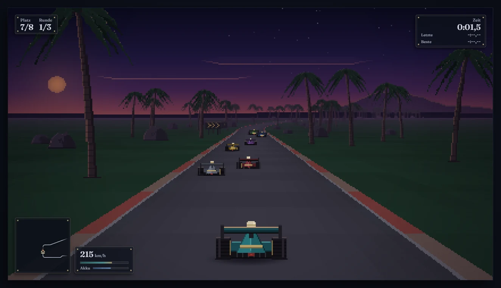
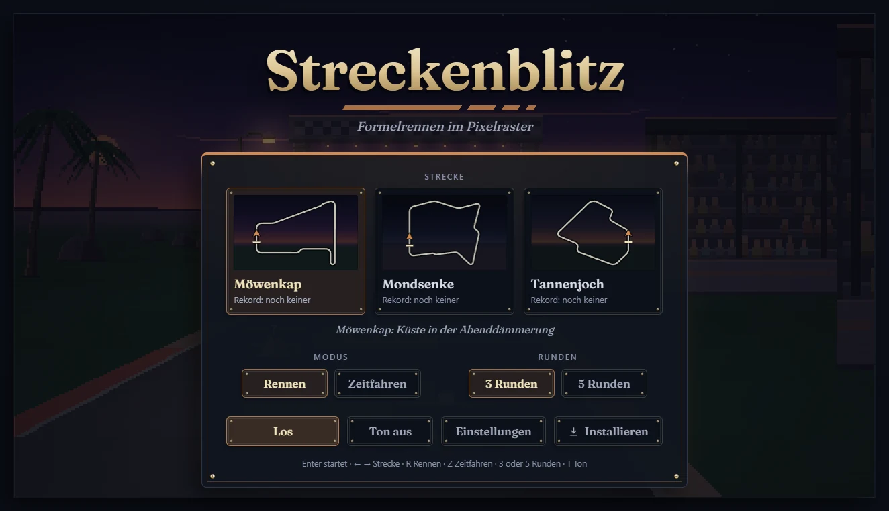

# Streckenblitz

**Ein Formelrennen im Browser, Ansicht hinter dem Auto, auf einem kleinen Pixelraster mit vollen Farben.** Drei Strecken in der Dämmerung, sieben Gegner, Zeitfahren mit Rekord je Strecke, dazu Rekuperation und ein E-Turbo. Dunkel, ohne einen einzigen Blitz. Am Rechner mit Tasten oder Gamepad, am Handy und Tablet mit den Fingern. Läuft direkt auf der Seite, lässt sich als App installieren und geht nach dem ersten Besuch auch offline.

  

**Spielen:** https://dennismit2n.github.io/streckenblitz/ · [English version](README.md)

## Was es ist

Ein eigenes Pseudo-3D-Rennspiel, wie die frühen Rennspiele auf Handhelds und in Spielhallen: Die Straße wird Stück für Stück projiziert, Kurven und Hügel entstehen aus aufaddierten Versätzen. Das Bild ist absichtlich klein (427 × 240 Pixel) und wird scharf und ganzzahlig vergrößert, die Farben aber sind voll: Himmelsverläufe, Dunst, Abendlicht, weiche Schatten. Alt und neu zugleich.

Angefangen hat es mit der Erinnerung an ein eher schwaches Formelspiel auf einem alten Handheld. Das geht besser, dachte ich. Es ist trotzdem kein Nachbau: Strecken, Namen, Fahrzeuge, Grafik, Klang und Menüs sind selbst erfunden und gezeichnet, ohne eine einzige Bilddatei. Jedes Sprite entsteht beim Start im Code.

## Strecken und Modi

| | |
|---|---|
| **Möwenkap** | Küste in der Abenddämmerung, mit Leuchtturm, Haarnadel und Hafenmole. |
| **Mondsenke** | Wüste in der Nacht unter Sternen, mit Kaktuskehre und Felsentor. |
| **Tannenjoch** | Bergwald im letzten Licht, mit Jägerkehre und Dorfgerade, die kurvigste der drei. |
| **Rennen** | Gegen sieben Gegner über 3 oder 5 Runden, mit Startampel, Windschatten und Ergebnis mit bester Runde je Fahrer. Jeder Gegner fährt mit eigenem Stil: einer drängt, einer verteidigt, einer spart. |
| **Zeitfahren** | Allein auf der Strecke. Die Bestzeit wird je Strecke gespeichert und steht in der Streckenwahl. |

Die Streckenwahl zeigt jede Strecke als Karte von oben. Im Rennen dreht sich unten links eine kleine Karte mit, du zeigst darauf immer nach oben, die Gegner sind Punkte in ihrer Farbe.

## Tempo, Rekuperation und E-Turbo

Bis 342 km/h auf der Geraden, und wer zu schnell in die Kurve geht, den trägt die Fliehkraft nach außen ins Gras. Dein Wagen hat einen Akku, der halb voll startet:

- **Laden:** Bremsen lädt ihn auf, Rollen ohne Gas ein wenig. Gas lädt nie, im Gras und im Stand lädt nichts.
- **Zünden:** Ab einem Viertel Ladung gibt der E-Turbo drei Sekunden Schub, kurz bis etwa 365 km/h, danach ruht er zwei Sekunden. Er zündet beim Drücken, Halten zündet nicht nach, und erst ab der Startlinie.
- **Abwägen:** Wer spät bremst, gewinnt in der Kurve, hat aber weniger im Akku für die nächste Gerade. Die Gegner spielen nach denselben Regeln.

## Steuerung

| | Tastatur | Gamepad | Finger |
|---|---|---|---|
| **Gas** | ↑ oder W | rechter Trigger oder A | Fläche rechts unten |
| **Bremse** | ↓, S oder Leertaste | linker Trigger oder B | Fläche links daneben |
| **Lenken** | ← → oder A D | linker Stick oder Steuerkreuz | Lenkzone links, die Stelle des Fingers lenkt |
| **Turbo** | E oder Umschalt | RB | Knopf über dem Gas |
| **Pause** | Esc oder P | Start | Knopf oben links |

Im Menü startet Enter, ← → wählt die Strecke, R und Z wählen Rennen oder Zeitfahren, 3 und 5 die Runden, T schaltet den Ton. Hochkant am Handy bittet das Spiel darum, das Gerät quer zu halten; „Trotzdem spielen“ geht auch.

## Licht und Darstellung

Ich bin sehr lichtempfindlich, darum ist Streckenblitz dunkel und ruhig gebaut. Es gibt keine Blitze und nichts blinkt. Die gestreiften Randsteine haben wenig Kontrast, damit sie bei Tempo nicht flimmern, und die Startampel geht nacheinander an und zusammen aus. Laufende Zahlen wie Zeit und Tempo wechseln höchstens zweimal in der Sekunde, das Tempo zeigt zusätzlich ein Balken. Der Schimmer am Tempo, wenn der Turbo läuft, blendet in einer halben Sekunde weich auf und ab. Das Prüfskript misst das Flimmern im Spielbild bei Höchsttempo.

- **Sehhilfen:** In den Einstellungen findest du dieselbe Auswahl wie in den anderen Werkzeugen der Werkstatt: Hoher Kontrast dunkel und hell (helle, breite Randlinie, einfarbige Randsteine, Kontur um jedes Auto), Farbenblind (Gegnerfarben nach Okabe und Ito, Startnummern auch auf der Karte) und Umgekehrte Farben.
- **Ton:** Motor mit Siebengang-Automatik, Reifen, Aufprall und das Surren des Turbos, alles im Browser synthetisiert, keine Musik. Das Spiel startet stumm, der Schalter im Menü merkt sich deine Wahl.
- **14 Sprachen:** Deutsch, Englisch, Spanisch, Französisch, Italienisch, Niederländisch, Polnisch, Portugiesisch, Türkisch, Russisch, Hindi, Chinesisch, Japanisch und Koreanisch, erkannt über deinen Browser und in den Einstellungen umstellbar. Einige Übersetzungen sind maschinell, Korrekturen nehme ich gern an.

## App und offline

Nach dem ersten Besuch hält ein Service Worker Streckenblitz auch ohne Verbindung bereit. In Chrome, Edge und Samsung Internet erscheint im Menü ein Knopf „Installieren“, der es als App im Vollbild und quer einrichtet. Auf dem iPhone geht das in Safari über „Zum Home-Bildschirm“. Du kannst die Dateien auch herunterladen und `index.html` doppelt anklicken; gespielt wird dann ohne Server, nur Installieren und offline brauchen einen.

## Datenschutz

- Kein Konto, keine Werbung, keine Cookies, kein Tracking. Das Spiel schickt nichts irgendwohin und lädt nichts von fremden Seiten, auch die Schrift liegt im Repo. Das kannst du im Netzwerk-Reiter der Entwicklertools nachsehen.
- Dein Browser merkt sich nur, was du selbst wählst: Sprache, Ton, Strecke, Darstellung und deine Bestzeiten.

## Entwicklung

Reines HTML, CSS und JavaScript, kein Bauschritt, keine Abhängigkeiten. `index.html` lädt die Module als einfache Skripte, deshalb geht auch der Doppelklick: `strecke.js` (die Strecken), `physik.js` (fester Takt mit 60 Schritten je Sekunde, Fliehkraft, Akku, Turbo und der Bot), `rennen.js` (Start, Gegner, Platzierung), `grafik.js` und `deko.js` (Zeichnung), `karte.js` (Streckenkarte), `ton.js` und `sprachen.js`.

Zwei Prüfskripte mit Node.js, ohne Pakete:

| Befehl | Was es prüft |
|---|---|
| `node tests/strecke.mjs` | Ohne Browser: Strecken geschlossen, Physik gleich bei jedem Lauf, der Bot fährt jede Strecke im Zielfenster, Rennen mit allen Gegnern, Akku und Turbo, Streckenkarte, alle 14 Sprachen mit denselben Texten, keine Gedankenstriche. |
| `node tests/spiel.mjs` | Im Browser (Microsoft Edge headless): Menü, Tasten, Gamepad, Finger, ganze Rennen auf allen drei Strecken, Flimmern bei Höchsttempo, Zahlentakt, Sehhilfen und Kontrast, Handy quer und hochkant auf mehreren Geräten, Service Worker. Erwartet das Spiel auf `python -m http.server 8644 --bind 127.0.0.1`. |

In `werkzeuge/` liegen `foto.mjs` (Bildschirmfotos und Bildrate über Edge headless) und `icons.mjs` (rendert die PNG-Icons aus den SVG-Vorlagen in `icons/`). Zum Spielen braucht es keins davon. Die Technik des Segment-Pseudo-3D ist gut beschrieben in Lou Gorenflos „Lou’s Pseudo 3d Page“ und Jake Gordons Artikelreihe „How to build a racing game“; beides war Wissensquelle, der Code ist selbst geschrieben.

## Lizenz

- Code, Grafik und Klang: [MIT](LICENSE).
- Die Schrift ist [Fraunces](https://github.com/undercasetype/Fraunces) von The Fraunces Project Authors, unter der SIL Open Font License 1.1 (`schrift/OFL.txt`).

© 2026 Dennis_mit_2n · Teil der [Werkstatt](https://dennismit2n.github.io/)
