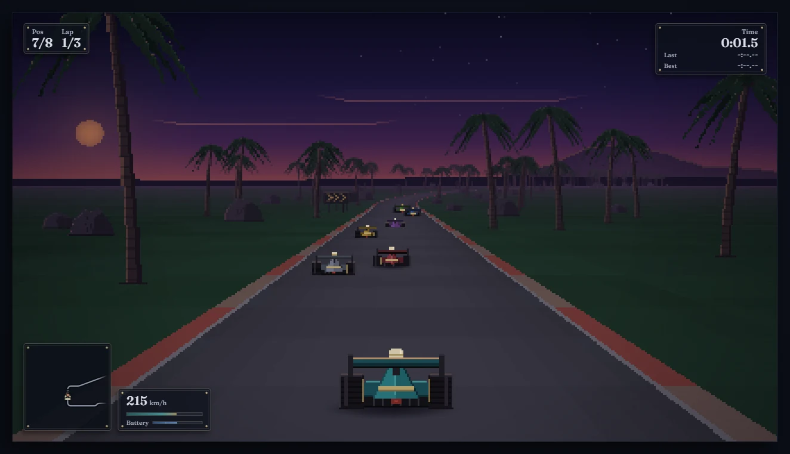
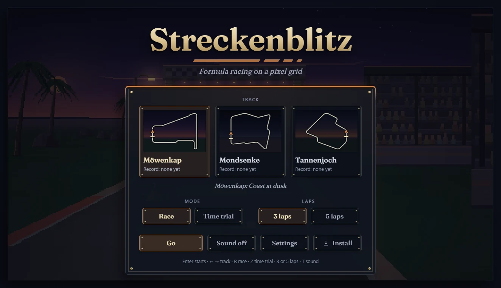

# Streckenblitz

**Formula racing in your browser, seen from behind the car, on a small pixel grid with full colors.** Three tracks at dusk, seven rivals, time trial with a record per track, plus brake regeneration and an e-boost. Dark, without a single flash. Keys or gamepad on a computer, your fingers on a phone or tablet. Runs right in the page, installs as an app and works offline after the first visit.

  

**Play:** https://dennismit2n.github.io/streckenblitz/ · [Deutsche Fassung](README.de.md)

## What it is

My own pseudo-3D racer in the style of the early racing games on handhelds and in arcades: the road is projected piece by piece, curves and hills come from accumulated offsets. The picture is small on purpose (427 × 240 pixels) and scaled up sharp in whole steps, but the colors are full: sky gradients, haze, evening light, soft shadows. Old and new at once.

It started with the memory of a rather weak formula game on an old handheld. That can be done better, I thought. It is still not a remake: tracks, names, cars, graphics, sound and menus are my own, drawn without a single image file. Every sprite is created in code when the game starts.

## Tracks and modes

| | |
|---|---|
| **Möwenkap** | Coast at dusk, with a lighthouse, a hairpin and a harbor pier. |
| **Mondsenke** | Desert at night under the stars, with a cactus bend and a rock gate. |
| **Tannenjoch** | Mountain forest in the last light, with a hunter’s bend and a village straight, the twistiest of the three. |
| **Race** | Against seven rivals over 3 or 5 laps, with start lights, slipstream and a result with every driver’s best lap. Each rival has a style of their own: one pushes, one defends, one saves the battery. |
| **Time trial** | Alone on the track. Your best time is stored per track and shown in the track choice. |

The track choice shows every track as a map from above. In the race a small map at the bottom left turns with you, you always point up, the rivals are dots in their colors.

## Speed, regeneration and e-boost

Up to 342 km/h on the straight, and if you enter a curve too fast, the centrifugal force carries you out onto the grass. Your car has a battery that starts half full:

- **Charging:** braking charges it, rolling without throttle a little. Throttle never charges, and nothing charges on the grass or standing still.
- **Firing:** from a quarter charge the e-boost pushes for three seconds, briefly up to about 365 km/h, then rests for two seconds. It fires when you press, holding does not fire again, and only after the start line.
- **Weighing up:** brake late and you gain in the curve, but you have less in the battery for the next straight. The rivals play by the same rules.

## Controls

| | Keyboard | Gamepad | Fingers |
|---|---|---|---|
| **Throttle** | ↑ or W | right trigger or A | area at the bottom right |
| **Brake** | ↓, S or Space | left trigger or B | area to its left |
| **Steer** | ← → or A D | left stick or D-pad | steering zone on the left, where your finger is sets the angle |
| **Boost** | E or Shift | RB | button above the throttle |
| **Pause** | Esc or P | Start | button at the top left |

In the menu Enter starts, ← → picks the track, R and Z pick race or time trial, 3 and 5 the laps, T toggles the sound. Held upright, the game asks you to turn your phone sideways; “Play anyway” works too.

## Light and appearance

I am very sensitive to light, so Streckenblitz is built dark and calm. There are no flashes and nothing blinks. The striped curbs have little contrast so they do not flicker at speed, and the start lights come on one by one and go out together. Running numbers like time and speed change at most twice a second, speed also has a bar. The glow at the speed plate while the boost runs fades in and out softly over half a second. The test script measures flicker in the game picture at top speed.

- **Visual aids:** in the settings you find the same choice as in the other tools of the workshop: high contrast dark and light (bright, wide edge line, plain curbs, an outline around every car), color-blind (rival colors after Okabe and Ito, race numbers on the map too) and inverted colors.
- **Sound:** engine with a seven-speed automatic, tires, impacts and the hum of the boost, all synthesized in the browser, no music. The game starts muted, the switch in the menu remembers your choice.
- **14 languages:** German, English, Spanish, French, Italian, Dutch, Polish, Portuguese, Turkish, Russian, Hindi, Chinese, Japanese and Korean, detected from your browser and changeable in the settings. Some translations are machine made, corrections are welcome.

## App and offline

After the first visit a service worker keeps Streckenblitz available without a connection. In Chrome, Edge and Samsung Internet an “Install” button appears in the menu and sets it up as a full-screen app in landscape. On the iPhone use Safari and “Add to Home Screen”. You can also download the files and double-click `index.html`; the game then runs without a server, only installing and offline need one.

## Privacy

- No account, no ads, no cookies, no tracking. The game sends nothing anywhere and loads nothing from other sites, the font is in the repo too. You can check that in the network tab of the developer tools.
- Your browser only remembers what you choose yourself: language, sound, track, appearance and your best times.

## Development

Plain HTML, CSS and JavaScript, no build step, no dependencies. `index.html` loads the modules as plain scripts, which is why the double-click works: `strecke.js` (the tracks), `physik.js` (fixed step of 60 per second, centrifugal force, battery, boost and the bot), `rennen.js` (start, rivals, positions), `grafik.js` and `deko.js` (drawing), `karte.js` (track map), `ton.js` and `sprachen.js`.

Two test scripts for Node.js, no packages:

| Command | What it checks |
|---|---|
| `node tests/strecke.mjs` | Without a browser: tracks closed, physics identical on every run, the bot drives every track inside the target window, races with all rivals, battery and boost, track map, all 14 languages with the same texts, no dashes. |
| `node tests/spiel.mjs` | In the browser (Microsoft Edge headless): menu, keys, gamepad, fingers, full races on all three tracks, flicker at top speed, number timing, visual aids and contrast, phone in landscape and portrait on several devices, service worker. Expects the game on `python -m http.server 8644 --bind 127.0.0.1`. |

`werkzeuge/` holds `foto.mjs` (screenshots and frame rate via Edge headless) and `icons.mjs` (renders the PNG icons from the SVG templates in `icons/`). You need none of them to play. The segment pseudo-3D technique is well explained in Lou Gorenflo’s “Lou’s Pseudo 3d Page” and Jake Gordon’s series “How to build a racing game”; both were a source of knowledge, the code is my own.

## License

- Code, graphics and sound: [MIT](LICENSE).
- The font is [Fraunces](https://github.com/undercasetype/Fraunces) by The Fraunces Project Authors, under the SIL Open Font License 1.1 (`schrift/OFL.txt`).

© 2026 Dennis_mit_2n · Part of the [workshop](https://dennismit2n.github.io/)
